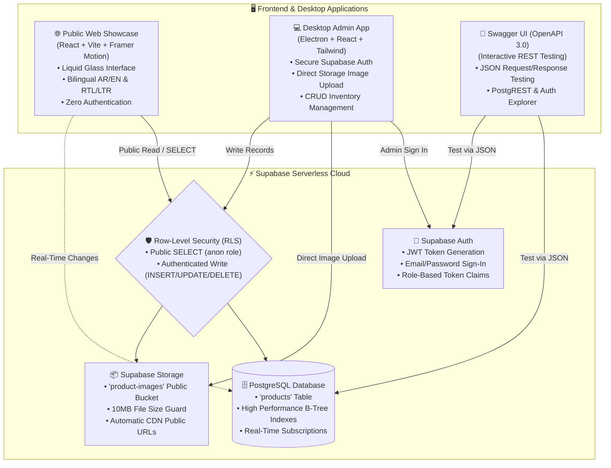

# 🚗 Shikhon (شيخون) - Premium Car Spare Parts Platform

<div align="center">

  

  <br/>

### **منصة شيخون الرقمية لقطع غيار السيارات الأصلية**
**Next-Generation Bilingual (Arabic & English) Auto Spare Parts Showcase & Management Ecosystem**

*Engineered with Apple visionOS / iOS 26 Liquid Glass Aesthetic, React, Vite, Electron, Supabase Serverless Cloud, and OpenAPI 3.0*

---

</div>

## 🌟 Executive Architecture Overview

Shikhon (شيخون) is an enterprise-grade car spare parts platform built with a 100% serverless backend architecture powered exclusively by Supabase PostgreSQL and Storage — completely eliminating custom backend server maintenance.



---

## 📁 Repository Structure

```
sikhon/
├── supabase/
│   ├── schema.sql                 # Production SQL: products table, storage bucket, RLS policies
│   ├── seed.sql                   # 8 high-performance car spare parts initial seed data
│   └── README.md                  # Supabase dashboard 1-click execution guide
│
├── web-showcase/                  # 🌐 Public Web Showcase App
│   ├── src/
│   │   ├── components/            # Navbar, Hero, ProductCatalog, ProductModal, Footer
│   │   ├── context/               # LanguageContext (Arabic RTL / English LTR)
│   │   ├── locales/               # ar.json & en.json dictionary resources
│   │   ├── lib/                   # Supabase client & fallback seed data
│   │   ├── index.css              # visionOS Liquid Glass utility classes & aurora mesh
│   │   └── App.jsx
│   ├── vite.config.js
│   ├── tailwind.config.js
│   └── package.json
│
├── desktop-admin/                 # 💻 Desktop Admin Dashboard (Electron + React)
│   ├── electron/                  # Electron main & preload process scripts
│   ├── src/renderer/
│   │   ├── components/            # AdminNavbar, LoginView, DashboardView, Add/Edit Modals
│   │   ├── context/               # AuthContext (Supabase Auth) & LanguageContext
│   │   ├── lib/                   # Supabase client & Storage upload helper
│   │   └── App.jsx
│   ├── vite.config.js
│   └── package.json
│
├── swagger-ui/                    # 📑 OpenAPI 3.0 Interactive API Explorer
│   ├── swagger.json               # Complete OpenAPI 3.0 spec for Supabase REST, Auth & Storage
│   ├── index.html                 # Dark liquid-glass interactive Swagger UI runner
│   └── README.md                  # Step-by-step JSON API testing instructions
│
└── package.json                   # Root monorepo orchestrator scripts
```

---

## 🎨 UI/UX Design System — True "Liquid Glass" Aesthetic

Inspired by Apple visionOS and iOS 26 liquid glass interface language:

- **Multi-Layered Translucency:** Built with `backdrop-filter: blur(28px) saturate(190%)` over subtle tinted glass surfaces (`rgba(255, 255, 255, 0.08)` to `0.02)`).
- **Specular Highlights:** Double-inset borders (`inset 0 1px 1px rgba(255, 255, 255, 0.35)`) and delicate linear rim reflections that replicate authentic physical glass optics.
- **Dynamic Cursor Glare:** Interactive spare part cards feature responsive light reflection that sweeps across the card header upon hover.
- **Animated Aurora Mesh:** Background fluid gradients in cyan, deep cobalt, and electric violet drift dynamically behind translucent panels.
- **Micro-Interactions:** Powered by Framer Motion for organic card expansion, smooth modal zooming, and fluid state changes.

---

## 🌐 Full Bilingual Architecture (Arabic & English)

- **Instant Switching:** Seamlessly toggled via the floating AR / EN Pill without reloading the page.
- **Directional Switching:** Dynamically controls `dir="rtl"` (Arabic) and `dir="ltr"` (English) on `document.documentElement`.
- **Dynamic Brand Name:**
  - Arabic Mode: **"شيخون"** with typography styled using Google's **Cairo** and **Readex Pro**.
  - English Mode: **"Shikhon"** with typography styled using **Plus Jakarta Sans** and **Inter**.
- **Real-Time Bilingual Search:** Queries are cross-matched instantaneously across both Arabic (`name_ar`) and English (`name_en`) simultaneously.

---

## 🚀 Quick Start Guide

### 1. Database & Storage Initialization
1. In your [Supabase Dashboard](https://supabase.com/dashboard), open the **SQL Editor**.
2. Run [`supabase/schema.sql`](supabase/schema.sql).
3. (Optional) Run [`supabase/seed.sql`](supabase/seed.sql) to populate initial car parts.

### 2. Configure Environment Variables
Copy `.env.example` to `.env` in `web-showcase` and `desktop-admin`:
```env
VITE_SUPABASE_URL=https://your-project-ref.supabase.co
VITE_SUPABASE_ANON_KEY=eyJhbGciOi...your-anon-key
```

### 3. Running the Public Web Showcase
```bash
npm run dev:web
```
Opens at `http://localhost:3000`.

### 4. Running the Desktop Admin App
- **Web Preview Mode:**
  ```bash
  npm run dev:admin
  ```
  Opens at `http://localhost:5174`.
- **Desktop Electron Window:**
  ```bash
  npm run dev:electron
  ```

### 5. Running Interactive Swagger UI
Open [`swagger-ui/index.html`](swagger-ui/index.html) directly in any browser, or run:
```bash
npm run dev:swagger
```
Opens at `http://localhost:8080`.

---

## 🧪 Testing REST Endpoints via Swagger UI with JSON

| Endpoint | Method | Role | JSON Payload Example |
| :--- | :--- | :--- | :--- |
| `/auth/v1/token?grant_type=password` | `POST` | Public | `{"email": "admin@shikhon.com", "password": "..."}` |
| `/rest/v1/products?select=*` | `GET` | Anon/Public | None (Query params) |
| `/rest/v1/products` | `POST` | Authenticated | `{"name_ar": "...", "name_en": "...", "image_url": "..."}` |
| `/rest/v1/products?id=eq.{id}` | `PATCH` | Authenticated | `{"name_ar": "...", "price": 199.99}` |
| `/rest/v1/products?id=eq.{id}` | `DELETE` | Authenticated | None (Path param) |
| `/storage/v1/object/public/product-images/{file}` | `GET` | Public | Binary image stream |

---

## 📄 License
MIT © 2026 Shikhon Platform Engineering
